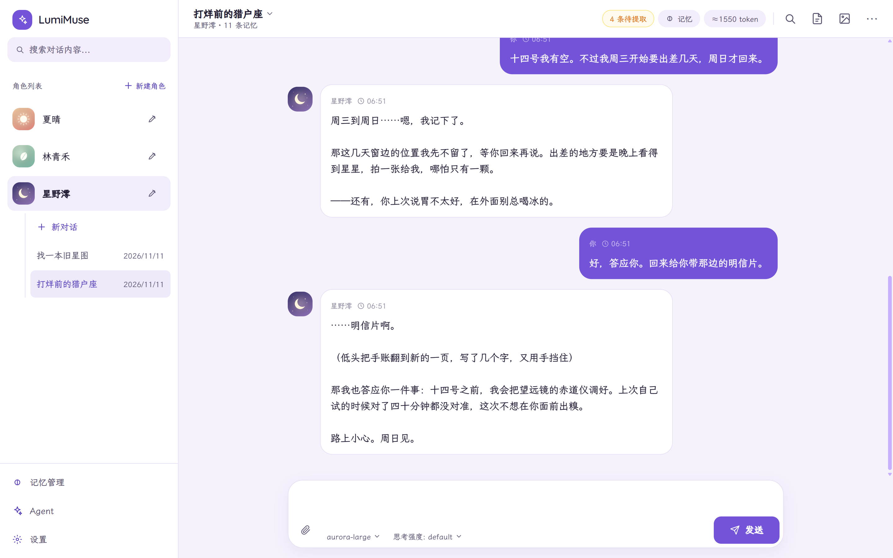
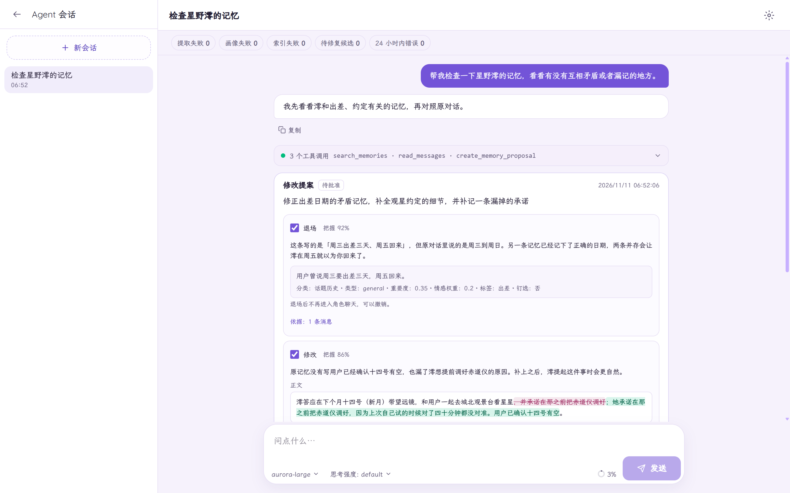
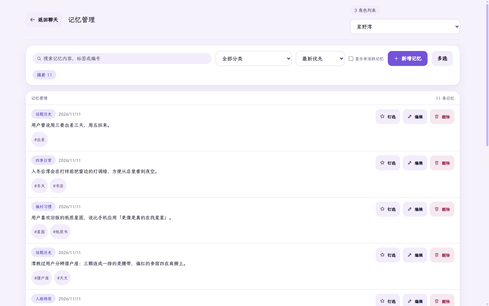
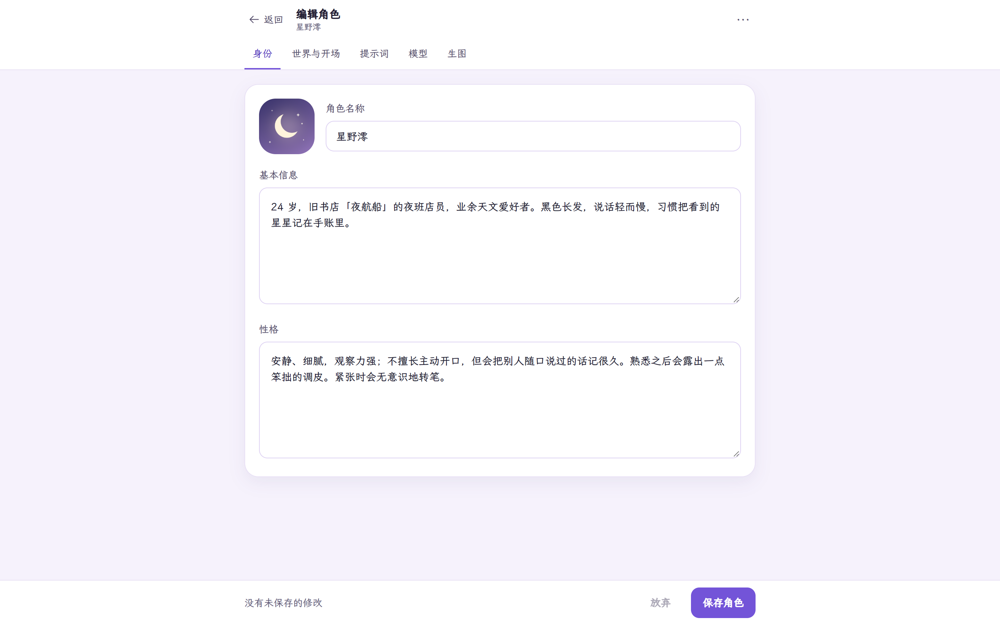
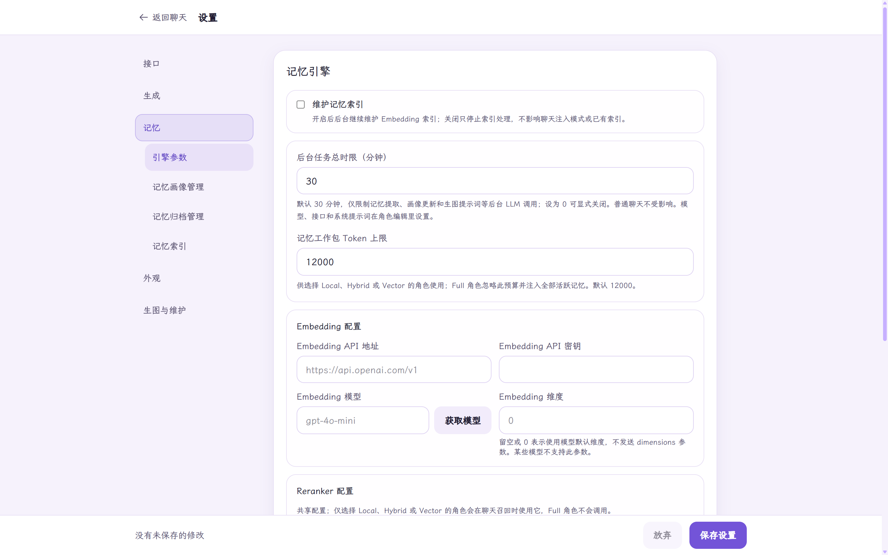
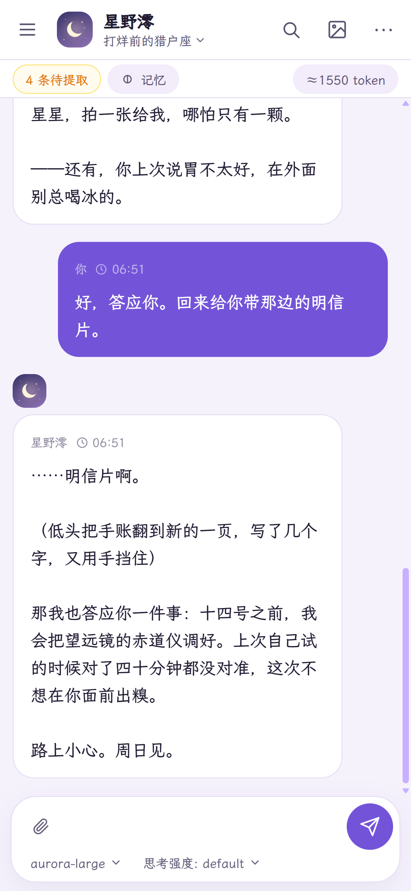
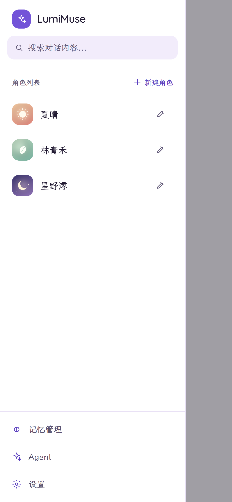
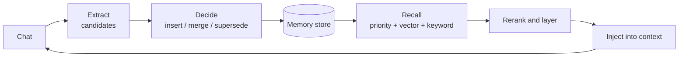

<div align="center">


# LumiMuse

**Let them slowly fill your room.**

A self-hosted AI companion app. Your characters remember what happens between you,<br/>
and a built-in steward helps you look after those memories. Your data stays on your own machine.

<br/>

[](https://github.com/in30mn1a/LumiMuse/actions/workflows/ci.yml)
[](https://nextjs.org)
[](https://react.dev)
[](https://www.typescriptlang.org)
[](https://www.sqlite.org)
[](#docker-deployment)
[](LICENSE)

[中文](README.md) · **English**

[Quick start](#quick-start) · [Features](#features) · [Memory](#memory-system) · [Built-in Agent](#built-in-agent) · [Deployment](#docker-deployment) · [FAQ](#faq)

<br/>

<picture>
  <source media="(prefers-color-scheme: dark)" srcset="assets/screenshots/chat-dark.png" />
  
</picture>

<sub>Screenshots show the Chinese interface; the app also ships a full English UI. All characters, chats and memories shown are fictional demo content.</sub>

</div>

<br/>

## What it is

LumiMuse is for people who want to spend **a long time** with a character. Write a personality and a greeting, connect any OpenAI-compatible model, and start talking. Over time the character remembers what you said, what you promised each other, and what you went through together.

It takes three things seriously:

- **Memory.** Long-term memories are extracted from your chats automatically and injected by relevance. The memory store can keep growing, and nothing is silently cut off as conversations get longer.
- **Control.** A built-in Agent can inspect and tidy your memories, character cards and past messages, but every change waits for your approval and can be undone afterwards.
- **Ownership.** One SQLite file and three media folders are all the data there is. Run it locally or deploy it to your own server with Docker.

## Screenshots

<table>
  <tr>
    <td width="50%" valign="top">
      
      <p align="center"><b>Built-in Agent</b><br/><sub>Reviews the memory store and turns changes into proposals you approve item by item</sub></p>
    </td>
    <td width="50%" valign="top">
      
      <p align="center"><b>Memories</b><br/><sub>Browse, search, pin and edit long-term memories per character</sub></p>
    </td>
  </tr>
  <tr>
    <td width="50%" valign="top">
      
      <p align="center"><b>Character editor</b><br/><sub>Identity, world and greeting, prompts, models and image settings in separate tabs</sub></p>
    </td>
    <td width="50%" valign="top">
      
      <p align="center"><b>Settings</b><br/><sub>API, generation, memory engine, appearance, image generation and maintenance</sub></p>
    </td>
  </tr>
</table>

<p align="center">
  
  &nbsp;&nbsp;&nbsp;&nbsp;
  
  <br/>
  <sub>Phones and tablets get their own layouts, and the app can be added to the home screen</sub>
</p>

## Features

| | | |
|:--|:--|:--|
| 🎭 | **Characters** | Personality, scenario, greeting, example dialogue, system prompt and image tags. Import SillyTavern character card JSON, or have the built-in Agent draft a card |
| 💬 | **Chat** | Streaming replies; edit, delete and regenerate messages and switch between versions; image and text attachments; manual summaries for long chats |
| 🧠 | **Long-term memory** | Automatic extraction, categorisation, de-duplication and superseding; optional vector search and reranking; character profiles, archiving and revision history |
| 🤖 | **Built-in Agent** | Reads characters, chats, memories and logs to troubleshoot, tidy memories and edit character cards. Every change starts as a proposal awaiting approval |
| 🧩 | **Prompt presets** | Import SillyTavern presets, set a default per character, and bind different presets to different chat models |
| 🎨 | **Image generation** | Stable Diffusion WebUI, NovelAI (including V5), ComfyUI and custom endpoints. Images keep their version history and can be managed or downloaded in bulk |
| 🔌 | **Multiple providers** | Save several API configurations; switch model and reasoning effort from the chat box, and pin the models you use most |
| 🕰️ | **Sense of time** | The real date and time go into the context, so a character knows what time it is and how long you have been away |
| 🔍 | **Search** | Search all messages, including CJK substring matching and date queries, and jump straight to the original message |
| 📦 | **Backup** | Export characters, memories, chats and presets selectively; one JSON file moves everything to another machine |
| 📱 | **Every screen** | Separate layouts for desktop, tablet and phone; light and dark themes; Chinese and English UI; adjustable font and text size |
| 🔒 | **Access control** | Optional access password, signed sessions and login rate limiting; outbound requests are guarded against SSRF (server-side request forgery) |

<details>
<summary><b>More chat details</b></summary>

<br/>

- Chats can be duplicated, including a lightweight copy that references the history without copying messages; chats under one character can be reordered by dragging
- The top bar shows a token estimate for the current context; open it to see how much the system prompt, memories and history each take
- A chat can be excluded from memory extraction, so testing a model or tuning a prompt does not pollute the memory store
- Reasoning effort is remembered per model and restored when you switch back
- Chat history is cached locally, so switching characters or reopening the page does not wait on a reload

</details>

## Quick start

You need Node.js **20.18.1 or newer** and a model endpoint that speaks the OpenAI Chat Completions format.

```bash
git clone https://github.com/in30mn1a/LumiMuse.git
cd LumiMuse
npm install
npm run dev
```

Open <http://localhost:3000>, then:

1. **Settings → API**: enter the base URL, key and model name. "Fetch models" will list what the endpoint offers.
2. **New character**: a name, a personality and a greeting are enough to begin.
3. **Start chatting.** Memories are extracted in the background and show up under "Memories" a little later.

The database is created automatically at `data/lumimuse.db`; no setup step is needed. On Windows you can also double-click `Start.bat` once dependencies are installed.

For Docker, skip to [Docker deployment](#docker-deployment).

## Memory system

The design principle is **unlimited storage, limited activation**: the memory store can grow indefinitely, while each turn only brings the relevant part into context.



**Extraction.** When a trigger fires (message count, time interval or keyword), a background task picks out what is worth keeping. It works in two passes: first it extracts candidate memories, then it looks up older memories that are semantically close to each candidate and decides whether to insert, merge or supersede. That is how "has taken up baking desserts" can find and replace "doesn't like sweets" instead of leaving two contradictory memories side by side.

**Injection.** Each character chooses its own mode:

| Mode | Behaviour |
|:--|:--|
| `full` (default) | Injects every active memory, with no cap |
| `local` | Local keyword recall, packed to a budget |
| `vector` | Semantic recall; requires an embedding endpoint |
| `hybrid` | Union of vector and keyword recall, with optional reranking |

Outside `full` mode, memories are packed in layers (pinned and high-importance → promises → preferences → relationship events → recalled this turn). The budget defaults to 12,000 tokens, and the upper bound is yours to set; the app does not clamp it.

**The other pieces:**

- **Character profile**: a structured summary of the relationship, recent story, emotional baseline and open threads, with manual editing and version rollback.
- **Archiving**: compresses a batch of old memories into a summary memory. The originals stay traceable and the operation can be undone.
- **Per-character background models**: extraction, profiles, summaries, archiving and image prompts can use a different provider, model, reasoning effort and system prompt from the chat itself.
- **Failures never block chat**: if vector search, reranking or a background task fails, the app falls back and the conversation continues. Failed tasks are recorded and can be handed to the Agent.

## Built-in Agent

The Agent is a steward that lives on the `/agent` page. It plays no character; its job is to look after your data.

**It can read** character cards, chats and messages, memories and their sources, character profiles, background task status and runtime logs.

**It can propose**, but never write directly:

| Proposal | What it covers |
|:--|:--|
| Memories | Create, update, retire, merge and archive; repair failed extractions; report memories that contradict each other |
| Character cards | Edit the text fields of an existing character, or draft a new card |
| Past messages | Correct the body of a message, without adding or removing messages or touching attachments |

Every item comes with a reason, a confidence level and the chat messages it is based on, and edits are shown as a diff. You can approve items individually, or reject the whole proposal with a note. Approved changes go into the revision history and can be undone; if the target has been modified since approval, the undo is refused and you are told why.

The Agent has its own instruction document and long-term notes, both editable (with version restore) from the settings drawer on its page. Its provider and model are configured separately, or it can share the main chat endpoint. Long sessions compact their context automatically, and a run in the background can be stopped at any time.

> The Agent is fully isolated from character chat: its existence does not change a single byte of what is sent to the chat model.

## Image generation

Enable it under **Settings → Image & Maintenance**. Four backends are supported:

| Backend | Notes |
|:--|:--|
| Stable Diffusion WebUI | Defaults to `http://127.0.0.1:7860`; the WebUI must have its API enabled |
| NovelAI | Requires an API key; supports Diffusion V5, where prompts switch to natural language with per-character sections |
| ComfyUI | Defaults to `http://127.0.0.1:8188`; you supply the workflow JSON |
| Custom endpoint | Any service compatible with the OpenAI image API format |

Characters can store their own appearance and style tags. The chat model can append an image prompt to its reply, so one click produces a picture without a second request. Regenerated images keep the older versions, which you can flip through in the chat.

> When LumiMuse runs in Docker and the image service runs on the host, `127.0.0.1` means the container itself. Use the host's LAN address and set `ALLOW_LOCAL_NETWORK=1`.

## Docker deployment

```bash
cp .env.local.example .env.local
# edit .env.local and set at least ACCESS_PASSWORD
docker compose up -d --build
```

Then open <http://localhost:3000>. In production mode the container refuses to start with an empty or placeholder password; if it does not come up, check `docker compose logs lumimuse` first.

### Environment variables

| Variable | Purpose |
|:--|:--|
| `ACCESS_PASSWORD` | Access password. Without it there is no login, which is only suitable for local use |
| `AUTH_SECRET` | Session signing secret. Derived from the password when unset, so changing the password signs everyone out |
| `ALLOW_LOCAL_NETWORK` | Set to `1` to allow private network addresses, needed for a local model or image service |
| `TRUST_PROXY` | Set to `1` to trust the client IP forwarded by a reverse proxy. Enable it only when the proxy overwrites `X-Forwarded-For`; the app port must not be reachable directly, bypassing the proxy |
| `TRUST_PROXY_HOPS` | Number of trusted proxy hops, default `1` |
| `LUMIMUSE_ENV_FILE` | Points Compose at a different env file; defaults to `.env.local` |

### Data directories

| Host | Container | Contents |
|:--|:--|:--|
| `./data` | `/app/data` | SQLite database |
| `./public/avatars` | `/app/public/avatars` | Character avatars |
| `./public/generated` | `/app/public/generated` | Generated images |
| `./public/attachments` | `/app/public/attachments` | Chat attachments |

The container runs as a non-root user (UID/GID **1001**). On Linux, hand the directories over before the first start:

```bash
sudo chown -R 1001:1001 data public/generated public/avatars public/attachments
```

### Updates and health checks

```bash
git pull
docker compose up -d --build
```

The database schema upgrades itself on startup. `/api/health` reports liveness, and `/api/health?ready=1` also checks that the database and the four directories are writable. The `build` field in the health response is the commit SHA recorded at build time; local Compose defaults to `local`, and your own images can pass `LUMIMUSE_BUILD_SHA=$(git rev-parse HEAD)`.

## Backup and migration

**In-app export** is the easiest route: open the "More" menu in the character editor, choose what to take with you (characters, memories, chats, profiles and so on), and import the resulting JSON file in the new environment. Prompt presets used by the character travel with it.

**If you copy files directly**, note that the database uses WAL (write-ahead logging), so copying only the `.db` file while the app is running loses the most recent writes. Use SQLite's online backup instead:

```bash
sqlite3 data/lumimuse.db "VACUUM INTO 'backup.db'"
```

Or stop the app first, then copy the whole `data/` directory together with the three media directories.

Migrations record their progress in SQLite's `user_version`. Before downgrading to an older version, stop the app, take a full backup, and restore from a backup that matches that version. Do not roll back by lowering `user_version` by hand.

## Data and privacy

- Characters, chats, memories and images are stored on your machine. The app never sends them to any server controlled by the author.
- The only outbound requests go to the model, embedding and image endpoints you configure yourself.
- API keys are masked before they are returned to the browser.
- For a public deployment, set an access password, use HTTPS and back up regularly.

## FAQ

<details>
<summary><b>Which models can I use?</b></summary>

<br/>

Any service compatible with the OpenAI Chat Completions format, including first-party APIs, relay services and local model gateways. Support for image input, reasoning effort and context length varies by model.

</details>

<details>
<summary><b>Fetching the model list fails. What now?</b></summary>

<br/>

Some services do not expose a model list endpoint; type the model name by hand. If the endpoint is on your machine or LAN, set `ALLOW_LOCAL_NETWORK=1`.

</details>

<details>
<summary><b>Why don't memories appear right away?</b></summary>

<br/>

Extraction is a background task that runs once a trigger condition is met. The top bar of the chat page shows how many messages are still waiting to be extracted.

</details>

<details>
<summary><b>Won't a growing memory store overflow the context?</b></summary>

<br/>

The default `full` mode injects every active memory on purpose: character quality comes first. When a character has a great many memories, switch it to `hybrid` or `vector` to recall by relevance, or ask the Agent to merge and archive older ones.

</details>

<details>
<summary><b>Can I import SillyTavern character cards and presets?</b></summary>

<br/>

Yes, in JSON form. Cards embedded in PNG images are not supported yet, and extension fields such as lorebooks may not be restored in full. Importing a preset produces a compatibility report.

</details>

<details>
<summary><b>Why is the app empty when I run <code>.next/standalone</code> directly?</b></summary>

<br/>

`npm start` (that is, `npm run start:standalone`) runs the standalone bundle at `.next/standalone/server.js`, the same thing the Docker image starts with `node server.js`. It reads and writes `data/` and media inside its own directory and does not include your workspace data. To check a production build from the source tree, use `npm run start:local`.

</details>

## Development

```bash
npm run dev          # dev server (Turbopack)
npm run lint         # ESLint
npm test             # unit tests (Node's built-in runner, in-memory database)
npm run regression   # regression scripts
npm run build        # production build
```

Run the full sequence before committing; it matches CI:

```bash
npm run lint && npm test && npm run regression && npm run build
```

CI runs on Ubuntu (Node 20.18 / Node 24) and Windows (Node 20.18), and builds the Docker image for a smoke test.

`package.json` currently has no PostCSS override; the PostCSS version is decided by Next.js and the lockfile. After upgrading Next, `npm explain postcss` shows the actual dependency tree and `npm prune --dry-run` previews the cleanup plan.

<details>
<summary><b>Tech stack and layout</b></summary>

<br/>

| Layer | Technology |
|:--|:--|
| Framework | Next.js 16 (App Router, `output: "standalone"`) |
| Frontend | React 19 · Tailwind CSS v4 |
| Language | TypeScript (strict) |
| Data | SQLite · better-sqlite3 (WAL) |
| Validation | Zod |
| Fonts | Quicksand · LXGW WenKai Screen |

```text
LumiMuse/
├─ src/
│  ├─ app/            pages and API routes
│  ├─ components/     chat, sidebar, memories, Agent, settings UI
│  ├─ lib/            database, model requests, memory engine, Agent, auth
│  └─ types/          domain types
├─ public/            icons, fonts and user media directories
├─ data/              SQLite database (created at runtime)
├─ tests/             tests
├─ scripts/           regression and evaluation scripts
├─ Dockerfile
└─ docker-compose.yml
```

</details>

## License

[MIT](LICENSE) © 2026 [in30mn1a](https://github.com/in30mn1a)

<div align="center">
<br/>
<sub>LumiMuse — let them slowly fill your room.</sub>
</div>
