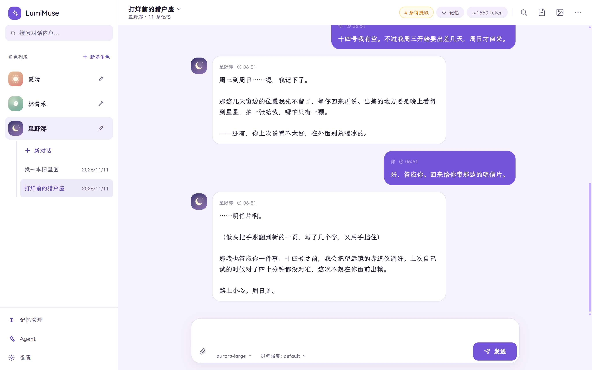
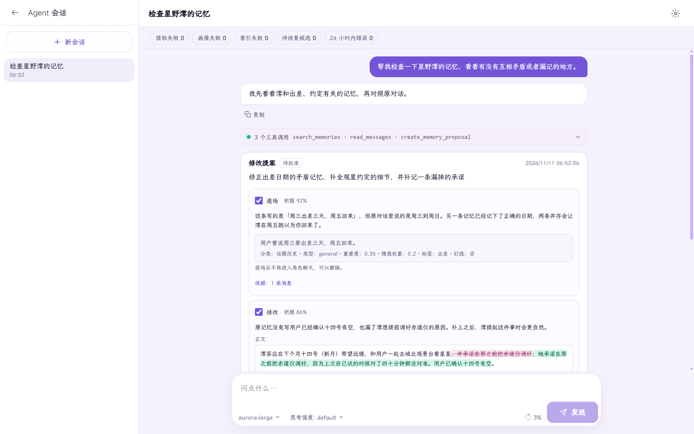
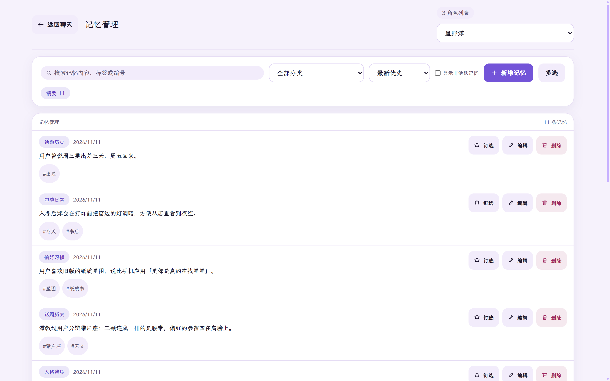
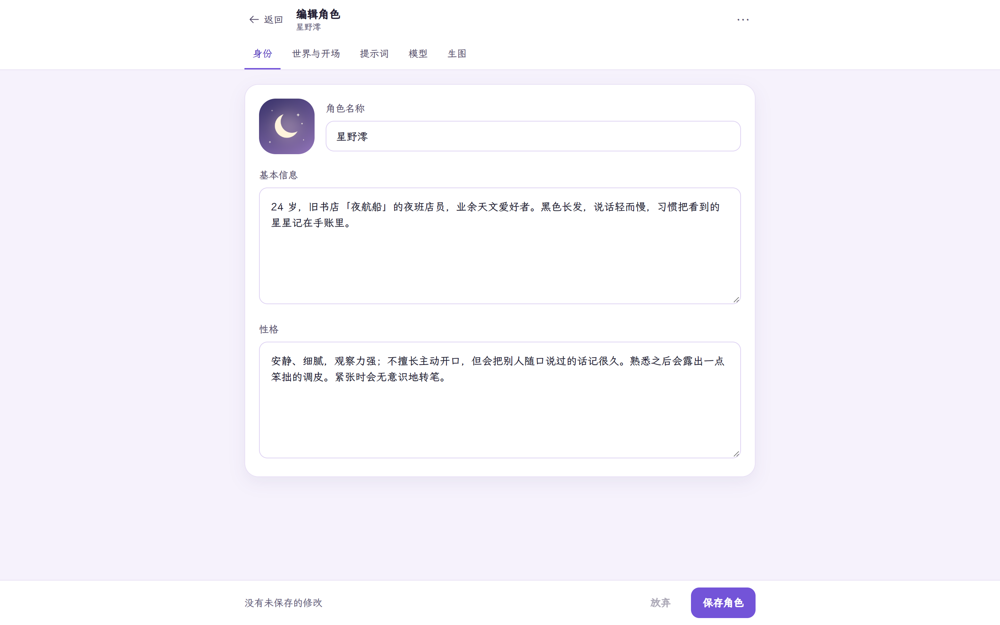
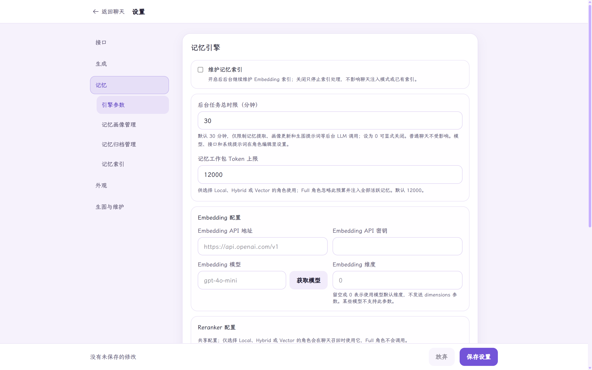
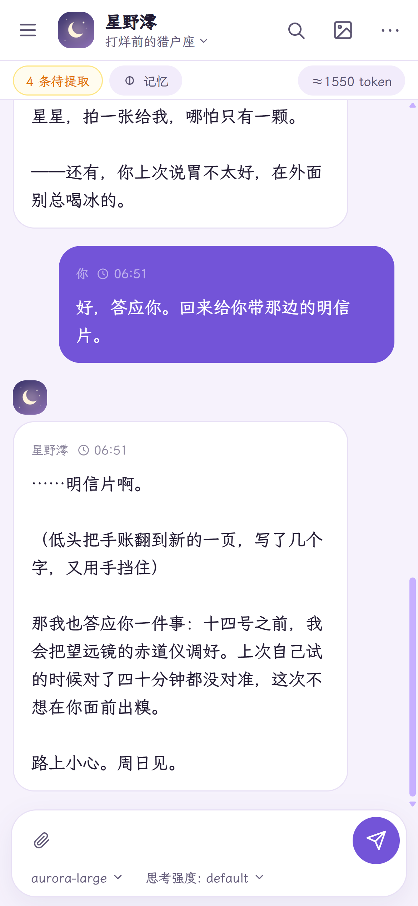
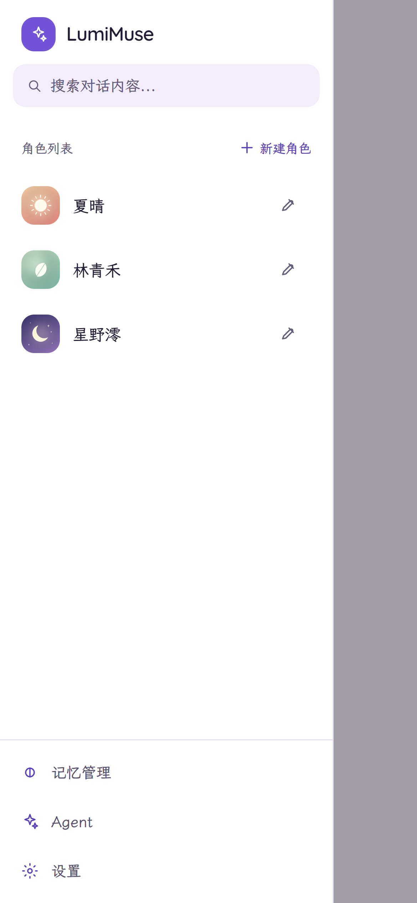
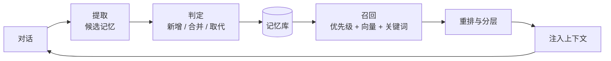

<div align="center">


# LumiMuse

**让 TA 慢慢填满你的房间。**

一个自托管的 AI 角色陪伴应用：角色会记住你们之间的事，<br/>
还有一位后台管家帮你照看这些记忆。数据只留在你自己的机器上。

<br/>

[](https://github.com/in30mn1a/LumiMuse/actions/workflows/ci.yml)
[](https://nextjs.org)
[](https://react.dev)
[](https://www.typescriptlang.org)
[](https://www.sqlite.org)
[](#docker-部署)
[](LICENSE)

**中文** · [English](README.en.md)

[快速开始](#快速开始) · [功能](#功能) · [记忆系统](#记忆系统) · [内置 Agent](#内置-agent) · [部署](#docker-部署) · [常见问题](#常见问题)

<br/>

<picture>
  <source media="(prefers-color-scheme: dark)" srcset="assets/screenshots/chat-dark.png" />
  
</picture>

<sub>截图里的角色、对话和记忆都是为演示编写的虚构内容。</sub>

</div>

<br/>

## 这是什么

LumiMuse 适合想和一个角色**长期相处**的人。你写下角色的性格和开场白，接上任意一个兼容 OpenAI 格式的模型，就可以开始聊天。聊得久了，角色会记得你说过的话、你们的约定和一起经历的事。

它有三件事做得比较认真：

- **记忆**。聊天中自动提取长期记忆，按相关性注入上下文。记忆可以一直增长，不会因为对话变长而被悄悄截掉。
- **可控**。记忆库、角色卡、历史消息都可以让内置 Agent 帮你检查和整理，但每一处修改都要你点头才会写入，写入后还能撤销。
- **自持有**。一个 SQLite 文件加三个媒体目录就是全部数据，本机运行或用 Docker 部署到自己的服务器都可以。

## 界面预览

<table>
  <tr>
    <td width="50%" valign="top">
      
      <p align="center"><b>内置 Agent</b><br/><sub>检查记忆库，把修改做成逐条可批准的提案</sub></p>
    </td>
    <td width="50%" valign="top">
      
      <p align="center"><b>记忆管理</b><br/><sub>按角色查看、搜索、钉选和编辑长期记忆</sub></p>
    </td>
  </tr>
  <tr>
    <td width="50%" valign="top">
      
      <p align="center"><b>角色编辑</b><br/><sub>身份、世界与开场、提示词、模型、生图分页填写</sub></p>
    </td>
    <td width="50%" valign="top">
      
      <p align="center"><b>设置</b><br/><sub>接口、生成参数、记忆引擎、外观、生图与维护</sub></p>
    </td>
  </tr>
</table>

<p align="center">
  
  &nbsp;&nbsp;&nbsp;&nbsp;
  
  <br/>
  <sub>手机和平板有单独适配的布局，可以添加到主屏幕当作应用使用</sub>
</p>

## 功能

| | | |
|:--|:--|:--|
| 🎭 | **角色** | 性格、场景、开场白、示例对话、系统提示词和生图标签；可以导入 SillyTavern 角色卡 JSON，也可以让内置 Agent 起草 |
| 💬 | **聊天** | 流式输出；消息可编辑、删除、重新生成并在多个版本间切换；支持图片和文本附件；长对话可手动总结 |
| 🧠 | **长期记忆** | 自动提取、分类、去重和取代；可选向量检索与重排；角色画像、归档和修订记录 |
| 🤖 | **内置 Agent** | 读取角色、对话、记忆和运行日志，排查问题、整理记忆、修改角色卡；所有改动先成为待批准提案 |
| 🧩 | **提示词预设** | 导入 SillyTavern 预设，按角色设置默认预设，也可以按聊天模型分别绑定 |
| 🎨 | **AI 生图** | Stable Diffusion WebUI、NovelAI（含 V5）、ComfyUI 和自定义接口；图片保留历史版本，可批量管理和打包下载 |
| 🔌 | **多接口** | 保存多套接口配置；聊天框里直接切换模型和思考强度，常用模型可以置顶 |
| 🕰️ | **时间感** | 把现实时间写进上下文，角色知道现在几点，也知道你隔了多久才回来 |
| 🔍 | **搜索** | 全局搜索消息，支持中文包含匹配和日期搜索，点击结果跳到原消息 |
| 📦 | **备份** | 按需导出角色、记忆、对话和预设；一个 JSON 文件即可迁移到另一台机器 |
| 📱 | **多端** | 桌面、平板、手机各有布局；明暗主题；中英文界面；字体和字号可调 |
| 🔒 | **访问保护** | 可选访问密码、签名会话、登录限流；出站请求有 SSRF（服务端请求伪造）防护 |

<details>
<summary><b>更多聊天细节</b></summary>

<br/>

- 对话可以复制，包括「只引用历史、不复制消息」的轻量复制；同一角色下的对话可以拖拽排序
- 顶栏显示当前上下文的 token 估算，点开能看到系统提示、记忆、历史各占多少
- 单个对话可以设为「不提取记忆」，试模型、调提示词时不会污染记忆库
- 思考强度按模型分别记忆，切换模型时自动恢复上次的选择
- 聊天记录有本地缓存，切换角色和重新打开页面时不用等待重新加载

</details>

## 快速开始

需要 Node.js **20.18.1 或更新**，以及一个兼容 OpenAI Chat Completions 格式的模型接口。

```bash
git clone https://github.com/in30mn1a/LumiMuse.git
cd LumiMuse
npm install
npm run dev
```

打开 <http://localhost:3000>，然后：

1. **设置 → 接口**：填入接口地址、密钥和模型名，可以点「获取模型」拉取列表。
2. **新建角色**：至少写名字、性格和开场白。
3. **开始聊天**。记忆会在后台自动提取，稍后可以在「记忆管理」里看到。

数据库会自动创建在 `data/lumimuse.db`，不需要额外初始化。Windows 上装好依赖后也可以直接双击 `Start.bat`。

想用 Docker 的话，跳到 [Docker 部署](#docker-部署)。

## 记忆系统

设计原则是**无限存储，有限激活**：记忆库可以一直增长，每一轮聊天只把相关的那部分放进上下文。



**提取。** 聊天达到触发条件（消息数、时间间隔或关键词）后，后台任务从对话里整理出值得长期保留的内容。提取分两步：先抽出候选条目，再拿每条候选去找语义相近的旧记忆，判断是新增、合并还是取代。这样「迷上了做甜点」能找到并取代「不爱吃甜」，不会让两条矛盾的记忆并存。

**注入。** 每个角色可以单独选择注入方式：

| 模式 | 行为 |
|:--|:--|
| `full`（默认） | 注入全部活跃记忆，不设上限 |
| `local` | 本地关键词召回，按预算装箱 |
| `vector` | 向量语义召回，需要配置 Embedding 接口 |
| `hybrid` | 向量与关键词召回取并集，可选重排 |

非 `full` 模式下，记忆按「钉选与高重要度 → 承诺 → 偏好 → 关系事件 → 本轮回忆」分层装箱，预算默认 12000 token，上限由你自己决定，应用不做钳制。

**其余部件：**

- **角色画像**：一份结构化摘要，记录关系状态、近期剧情、情绪基调和未完成的事，支持手动编辑和版本回滚。
- **归档**：把一批旧记忆压缩成摘要记忆，原条目保留可追溯，可以撤销。
- **按角色配置后台模型**：提取、画像、总结、归档和生图提示词可以用和聊天不同的接口、模型、思考强度和系统提示词。
- **失败不阻塞**：向量检索、重排或后台任务出错时自动回退，聊天不受影响；失败的任务会留下记录，可以交给 Agent 处理。

## 内置 Agent

Agent 是住在 `/agent` 页面的后台管家。它不扮演任何角色，工作是帮你照看数据。

**它能读**：角色卡、对话与消息、记忆及其来源、角色画像、后台任务状态和运行日志。

**它能提议**，但不能直接改：

| 提案类型 | 内容 |
|:--|:--|
| 记忆 | 新增、修改、退场、合并、归档，修复提取失败的记录，报告互相矛盾的条目 |
| 角色卡 | 修改现有角色的文本设定，或起草一张新角色卡 |
| 历史消息 | 修正某条消息的正文，不增删消息、不动附件 |

每一项提案都附带理由、把握程度和原对话依据，修改处以差异对比显示。你可以逐项勾选批准、整份拒绝并说明原因。批准后的改动会记入修订历史，可以撤销；如果目标在批准后又被改动过，撤销会被拒绝并告诉你原因。

Agent 有自己的指令文档和长期笔记，可以在页面的设置抽屉里编辑和恢复历史版本。它使用的接口和模型独立配置，也可以沿用主聊天接口。长会话会自动压缩上下文，后台运行的任务可以随时停止。

> Agent 与角色聊天完全隔离：它的存在不会改变发给聊天模型的任何内容。

## AI 生图

在 **设置 → 生图与维护** 里开启，支持四种后端：

| 后端 | 说明 |
|:--|:--|
| Stable Diffusion WebUI | 默认 `http://127.0.0.1:7860`，需要 WebUI 开启 API |
| NovelAI | 需要 API Key；支持 Diffusion V5，此时提示词改用自然语言加角色栏写法 |
| ComfyUI | 默认 `http://127.0.0.1:8188`，需要提供工作流 JSON |
| 自定义接口 | 兼容 OpenAI 图片接口格式的服务 |

角色可以保存自己的外貌和画风标签。聊天模型可以在回复末尾顺带产出生图提示词，点一下就能出图，不需要再单独请求一次。重新生成的图片会保留旧版本，在对话里可以前后翻看。

> LumiMuse 跑在 Docker 里、生图服务跑在宿主机时，`127.0.0.1` 指的是容器自己。请改用宿主机的局域网地址，并设置 `ALLOW_LOCAL_NETWORK=1`。

## Docker 部署

```bash
cp .env.local.example .env.local
# 编辑 .env.local，至少设置 ACCESS_PASSWORD
docker compose up -d --build
```

启动后访问 <http://localhost:3000>。生产模式下容器会拒绝空密码和示例占位密码，启动失败时先看 `docker compose logs lumimuse`。

### 环境变量

| 变量 | 说明 |
|:--|:--|
| `ACCESS_PASSWORD` | 访问密码。不设置则无需登录，只适合本机使用 |
| `AUTH_SECRET` | 会话签名密钥。不设置时由密码派生，改密码会让所有会话失效 |
| `ALLOW_LOCAL_NETWORK` | 设为 `1` 允许访问内网地址，接入本机的模型或生图服务时需要 |
| `TRUST_PROXY` | 设为 `1` 信任反向代理传来的客户端 IP。只在代理会覆盖 `X-Forwarded-For` 时开启，且应用端口不得绕过代理直连 |
| `TRUST_PROXY_HOPS` | 多级代理时的可信层数，默认 `1` |
| `LUMIMUSE_ENV_FILE` | 让 Compose 读取其他环境文件，默认 `.env.local` |

### 数据目录

| 宿主机 | 容器 | 内容 |
|:--|:--|:--|
| `./data` | `/app/data` | SQLite 数据库 |
| `./public/avatars` | `/app/public/avatars` | 角色头像 |
| `./public/generated` | `/app/public/generated` | 生成的图片 |
| `./public/attachments` | `/app/public/attachments` | 对话附件 |

容器以非 root 用户（UID/GID **1001**）运行。Linux 上首次启动前需要把目录交给它：

```bash
sudo chown -R 1001:1001 data public/generated public/avatars public/attachments
```

### 更新与健康检查

```bash
git pull
docker compose up -d --build
```

数据库结构会在启动时自动升级。`/api/health` 返回进程存活状态，`/api/health?ready=1` 额外检查数据库和四个目录是否可写。健康响应里的 `build` 字段是构建时写入的 commit SHA，本地 Compose 默认为 `local`，自建镜像可以传入 `LUMIMUSE_BUILD_SHA=$(git rev-parse HEAD)`。

## 备份与迁移

**应用内导出**是最省心的方式：在角色编辑页的「更多」菜单里选择要带走的内容（角色、记忆、对话、画像等），得到一个 JSON 文件，在新环境导入即可。角色用到的提示词预设会一并带上。

**直接备份文件**时注意数据库开启了 WAL（预写日志）模式，运行中只复制 `.db` 文件会丢掉最近的写入。请用 SQLite 的在线备份：

```bash
sqlite3 data/lumimuse.db "VACUUM INTO 'backup.db'"
```

或者先停掉应用，再复制整个 `data/` 目录和三个媒体目录。

数据库迁移会写入 SQLite 的 `user_version`。降级到旧版本前请先停止应用并做完整备份，再用与旧版匹配的备份恢复；不要靠手动调低 `user_version` 来回滚。

## 数据与隐私

- 角色、对话、记忆和图片都保存在你的机器上，应用不会把它们发往任何作者控制的服务器。
- 向外发出的请求只有你自己配置的模型接口、Embedding 接口和生图接口。
- 接口密钥在返回前端时会被掩码替换。
- 部署到公网时，请设置访问密码、使用 HTTPS，并定期备份。

## 常见问题

<details>
<summary><b>可以接入哪些模型？</b></summary>

<br/>

任何兼容 OpenAI Chat Completions 格式的服务都可以，包括各家官方接口、中转服务和本地模型网关。不同模型对图片输入、思考强度和上下文长度的支持有差异。

</details>

<details>
<summary><b>模型列表拉取失败怎么办？</b></summary>

<br/>

有些服务不提供模型列表接口，直接手动填写模型名即可。如果接口在本机或内网，需要设置 `ALLOW_LOCAL_NETWORK=1`。

</details>

<details>
<summary><b>为什么记忆没有立刻出现？</b></summary>

<br/>

记忆提取是后台任务，满足触发条件后才会运行。聊天页顶栏会显示还有多少条消息等待提取。

</details>

<details>
<summary><b>记忆越来越多，会不会把上下文撑爆？</b></summary>

<br/>

默认的 `full` 模式会注入全部活跃记忆，这是有意的选择：角色表现优先。记忆很多时，可以给角色换成 `hybrid` 或 `vector` 模式按相关性召回，或者让 Agent 帮你合并、归档旧记忆。

</details>

<details>
<summary><b>可以导入 SillyTavern 的角色卡和预设吗？</b></summary>

<br/>

可以导入 JSON 格式的角色卡和提示词预设。嵌在 PNG 图片里的角色卡暂不支持，世界书等扩展字段不一定完整还原。预设导入后会给出一份兼容说明。

</details>

<details>
<summary><b>直接运行 <code>.next/standalone</code> 为什么是空的？</b></summary>

<br/>

`npm start`（即 `npm run start:standalone`）运行的是 `.next/standalone/server.js` 这份独立打包的应用，Docker 镜像里执行的 `node server.js` 就是它。它在自己的目录下读写 `data/` 和媒体文件，不包含工作区里的数据。想在源码目录检查生产构建，用 `npm run start:local`。

</details>

## 开发

```bash
npm run dev          # 开发服务器（Turbopack）
npm run lint         # ESLint
npm test             # 单元测试（Node 内置 test runner，数据库用内存实例）
npm run regression   # 回归脚本
npm run build        # 生产构建
```

提交前请跑完整的验证序列，与 CI 一致：

```bash
npm run lint && npm test && npm run regression && npm run build
```

CI 在 Ubuntu（Node 20.18 / Node 24）和 Windows（Node 20.18）上运行，并构建 Docker 镜像做冒烟测试。

`package.json` 目前未配置 PostCSS override，PostCSS 的版本由 Next.js 和锁文件决定。升级 Next 之后可以用 `npm explain postcss` 查看实际依赖树，用 `npm prune --dry-run` 核对依赖清理计划。

<details>
<summary><b>技术栈与目录结构</b></summary>

<br/>

| 层 | 技术 |
|:--|:--|
| 框架 | Next.js 16（App Router，`output: "standalone"`） |
| 前端 | React 19 · Tailwind CSS v4 |
| 语言 | TypeScript（strict） |
| 数据 | SQLite · better-sqlite3（WAL） |
| 校验 | Zod |
| 字体 | Quicksand · 霞鹜文楷屏幕版 |

```text
LumiMuse/
├─ src/
│  ├─ app/            页面与 API 路由
│  ├─ components/     聊天、侧边栏、记忆、Agent、设置等界面
│  ├─ lib/            数据库、模型请求、记忆引擎、Agent、鉴权
│  └─ types/          领域类型
├─ public/            图标、字体与用户媒体目录
├─ data/              SQLite 数据库（运行时生成）
├─ tests/             测试
├─ scripts/           回归与评测脚本
├─ Dockerfile
└─ docker-compose.yml
```

</details>

## 许可

[MIT](LICENSE) © 2026 [in30mn1a](https://github.com/in30mn1a)

<div align="center">
<br/>
<sub>LumiMuse — 让 TA 慢慢填满你的房间。</sub>
</div>
